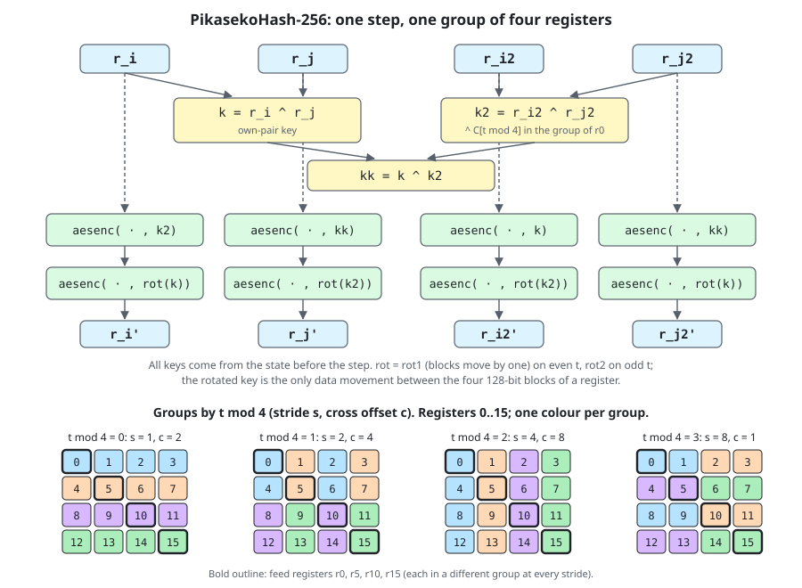

# PikasekoHash-256

PikasekoHash-256 is an experimental 256-bit hash function built from AES
rounds over a wide state of sixteen 512-bit registers (8192 bits). It is
designed for CPUs with AVX-512 and VAES (AMD Zen 4 and Zen 5, Intel Ice Lake
and later); on one Zen 5 core it hashes about 24 GB/s and a short message
in about 36 ns. It can be used keyed (512-bit key) or unkeyed.
A portable C implementation gives bit-identical results on any platform.
This repository holds the specification, both implementations, test
vectors, and the security analysis made so far.

Author: Jyrki Alakuijala (co-author of HighwayHash).

[](https://github.com/jyrkialakuijala/pikasekohash/actions)

## Status: experimental, not for production cryptographic use

This is version 0 of a research design. Do not use it where a vetted
cryptographic hash or MAC is required (use SHA-256, SHA-3, BLAKE3 or
similar). Known facts:

* **Free-start collisions are practical.** The step function is not a
  permutation, and collisions of a single step can be constructed in
  constant time from a chosen state. So free-start collisions of the
  compression function and of the finalization are practical (the two
  colliding chaining values are not reachable from the fixed initial value).
  Five explicit one-step collision pairs are in
  [analysis/data/](analysis/data/) and are checked by `make test`.
* No collision, second preimage or preimage of the hash itself is known, and
  no distinguisher of the full hash. Whether a semi-free-start collision
  (same chaining value, different packets) is practical is open; no security
  claim should be made before that is settled.
* Proven bounds exist only in byte-level truncated models, and they count
  probability only for the steps an attacker cannot steer.
* There is no domain separation: the all-zero key gives the public unkeyed
  hash.
* The design may still change (section 13 of [ANALYSIS.md](ANALYSIS.md)).
  Test vectors will then change too.

See [ANALYSIS.md](ANALYSIS.md) for the full security and quality analysis and
[analysis/reviews/](analysis/reviews/) for the review reports. Cryptanalysis
is welcome; see [SECURITY.md](SECURITY.md).

## Requirements

* A C11 compiler (gcc, clang, or MSVC through CMake) and `make` or CMake.
* For the fast implementations: a compiler that supports
  `-mavx512f -mavx512bw -mvaes -mavx2 -maes`. The library checks the CPU at
  run time and uses the fastest implementation it supports: AVX-512 + VAES,
  AVX2 + VAES (e.g. Zen 3, Alder Lake), AES-NI (any x86-64 CPU since about
  2010), on AArch64 the ARMv8 AES instructions (`-march=armv8-a+crypto`), or
  the portable one.
* The portable implementation is plain C and runs on any CPU and byte order.

## Build and test

    make            # library, tests, benchmark and tools in build/
    make test       # test vectors; AVX-512 against portable for lengths 0..2048;
                    # the one-step collision pairs
    make bench      # speed, unkeyed and keyed (AVX-512 builds)
    make bench-portable
    make battery    # 256-bit statistical battery (single-threaded, a few minutes)
    make fuzz       # libFuzzer (clang): all implementations against portable
    make test-python  # the Python reference (ref/pikaseko256.py) against the vectors
    make clean

The library is `build/libpikaseko256.a`; the header is
`include/pikaseko256.h`.

Build options:

* `make PORTABLE=1` builds only the portable code (the default when the
  compiler does not target x86-64). That library has no `_avx512`
  functions; the unsuffixed ones use the portable code. Programs are built
  with `-DPIKASEKO256_PORTABLE_ONLY`.
* `make test` checks the CPU at run time. Without AVX-512F, AVX-512BW, VAES
  and OS support for the zmm state it runs only the portable tests, says
  that the AVX-512 tests were skipped, and still succeeds.
  `PIKASEKO256_FORCE_PORTABLE=1 make test` forces that path.
* Cross builds take `CC`, `AR`, `LDFLAGS` and `RUN` (an emulator prefix), for
  example a big-endian test:
  `make PORTABLE=1 CC=s390x-linux-gnu-gcc AR=s390x-linux-gnu-ar LDFLAGS=-static RUN=qemu-s390x test`.
* CMake: `cmake -B build/cmake && cmake --build build/cmake && ctest --test-dir build/cmake`
  (CMake 3.20 or newer for `--test-dir`), with options
  `-DPIKASEKO256_SIMD=ON|OFF` and `-DPIKASEKO256_BUILD_TESTS=OFF`.

Other tools:

* `tools/diffusion.c`: bytes of the state reached by a one-bit difference
  after each step (output in `analysis/results/diffusion.txt`).
* `tools/battery.c`: the statistical battery (output in
  `analysis/results/battery.txt`).
* `tools/verify_step_collisions.c`: checks the explicit one-step collision
  pairs in `analysis/data/step_collision_t{1,3,5,7,9}.txt` (see ANALYSIS.md,
  section 4).

## API

`include/pikaseko256.h`:

```c
// 256-bit hash. key: eight 64-bit words, or NULL for the zero key.
void pikaseko256(const void* data, size_t len, const uint64_t key[8], uint64_t out[4]);
// Same as pikaseko256 with the zero key.
void pikaseko256_unkeyed(const void* data, size_t len, uint64_t out[4]);
// 64-bit hash: out[0] of pikaseko256.
uint64_t pikaseko64(const void* data, size_t len, const uint64_t key[8]);

// Streaming: same result as pikaseko256 for the concatenation of the pieces.
// final does not change the context.
void pikaseko256_init(pikaseko256_ctx* ctx, const uint64_t key[8]);
void pikaseko256_update(pikaseko256_ctx* ctx, const void* data, size_t len);
void pikaseko256_final(const pikaseko256_ctx* ctx, uint64_t out[4]);

// 1 when the functions above run the AVX-512 code (checked once).
int pikaseko256_uses_avx512(void);
```

These functions use the AVX-512 implementation when the CPU and OS support
AVX-512F, AVX-512BW and VAES and the portable one otherwise, with the same
results. Each implementation is also available by name, with the suffix
`_avx512` (the caller checks the CPU; absent from portable-only builds) or
`_portable` (any CPU, any byte order, constant time). The streaming context
is the same for both, so a hash can be continued with either. Setting
`PIKASEKO256_FORCE_PORTABLE=1` before the first call selects the portable
code.

`include/pikaseko256_analysis.h` declares the step function alone, for
analysis: `pikaseko256_steps(state, t0, nsteps)` runs nsteps steps from step
index t0 on a 128-word state (word 8i + l is lane l of register i), and
`pikaseko256_steps_avx512` and `pikaseko256_steps_portable` are the two
implementations.

Example:

```c
#include "pikaseko256.h"

uint64_t key[8];      // 512-bit secret key, filled by the caller
uint64_t digest[4];
pikaseko256(msg, msg_len, key, digest);  // AVX-512 + VAES if available, else portable
```

Byte order: key word i is bytes 8i .. 8i + 7 of a 64-byte key,
little-endian. The canonical 32-byte digest is out[0], out[1], out[2], out[3],
each written little-endian. `pikaseko256_key_from_bytes(key, bytes64)` and
`pikaseko256_digest_to_bytes(bytes32, out)` (inline, in the header) convert
on any host.

Notes for use:

* The zero key and the NULL key give the unkeyed hash. There is no domain
  separation between keyed and unkeyed use, or between the 64-bit and the
  256-bit output. Never use an all-zero key as a secret.
* For a message in pieces, use `pikaseko256_init`, `pikaseko256_update` and
  `pikaseko256_final` (and their `_portable` versions); the result equals the
  one-shot function.
* The message length is not hidden: running time depends on it.

## Speed

AMD Ryzen 9 9950X3D (Zen 5), one core at about 5.5 GHz, data in cache,
AVX-512 implementation built with gcc 15 (`make bench`). A key adds about 2 ns.

| input | unkeyed | keyed |
|---|---:|---:|
| 0 to 128 bytes | 36 ns | 38 ns |
| 256 bytes | 45 ns | 47 ns |
| 1 KiB | 76 ns | 78 ns |
| 1 MiB | 24.3 GB/s | 24.6 GB/s |

In bulk the loop takes about 14.5 core cycles per 64 bytes; it is bound by the
two AES pipes (96 AES rounds per 256 bytes at two per cycle is 48 of its about
58 cycles). Timings vary by a few percent between runs.
With clang 21 the AVX-512 code is about 10% slower on short inputs (40 ns at
8 bytes) and 23.7 GB/s in bulk; gcc is recommended for it.

Every message costs at least 9 steps (288 AES rounds on 512-bit vectors),
which sets the latency floor for short inputs.

On CPUs without AVX-512 the library uses narrower code (`make bench` then
reports it; `./build/bench --impl avx2` or `--impl aesni` measures it on any
CPU that has it). Measured on the same Zen 5 core, unkeyed:

| implementation | 0 to 128 bytes | 1 KiB | bulk |
|---|---:|---:|---:|
| AVX2 + VAES (two 256-bit vectors per register) | 93 ns | 0.32 µs | 9 to 10 GB/s |
| AES-NI (four 128-bit vectors per register) | 240 ns | 1.2 µs | 2.4 GB/s |

Sixteen 512-bit registers do not fit in the sixteen ymm or xmm registers, so
these versions spill; they have not been measured on the CPUs they are meant
for. The ARMv8 version (`src/pikaseko256_neon.c`, the same body with AESE and
AESMC) is tested in CI on arm64 but not yet measured.

The portable implementation uses a bitsliced AES (constant time, no tables,
no intrinsics). On the same machine (gcc -O2, `make bench-portable`) it takes
about 6 µs per short message, 15 µs for 1 KiB and runs at about 118 MB/s in
bulk, roughly 200 times slower than the AVX-512 code. With clang 21 it is about 10% faster
(5.8 µs per short message, 129 MB/s).

## Test vectors

`test/test_vectors.txt`. Byte i of the message is i mod 256; each line gives
out[0..3] in hex. The unkeyed hash of the empty message is

    4ce9ce973810692d 933bdf92669b1d6e 277e33f96dacc156 9b8ea902b68c1524

More vectors, including keyed ones, are in section 11 of [SPEC.md](SPEC.md).

## Construction

The state is sixteen 512-bit registers, each four 128-bit AES blocks. The
initial value is computed from 32-bit words of pi, e and the golden ratio,
and the key is xored into it. A step splits the registers into four groups
of four (with a stride that cycles 1, 2, 4, 8). Each register gets two AES
rounds whose round keys are xors of other registers of its group; the
second key is rotated by one or two blocks, which carries data between
blocks. One group also takes a constant derived from pi. A one-bit
difference reaches every register after three steps and practically every
byte of the state after four. The message is cut
into 64-byte packets with Merkle-Damgard strengthening. Four packets are
added into four registers every three steps. One step later, each packet
register is multiplied (32 x 32 -> 64 bits per lane) with a neighbouring
register, and the products are xored into four other registers after the
third step. After the last packets come six more steps. The output is the
sum of all registers, passed through two AES rounds keyed by sums of other
registers and folded to 256 bits.



The full definition is in [SPEC.md](SPEC.md).

## Documents

* [SPEC.md](SPEC.md): the complete definition and test vectors.
* [ANALYSIS.md](ANALYSIS.md): security and quality analysis, open problems
  and planned changes.
* [paper/pikasekohash.md](paper/pikasekohash.md): a paper describing the
  design, its rationale, the security analysis and measurements.
* [analysis/reviews/](analysis/reviews/): five review reports on the design.
* [SECURITY.md](SECURITY.md): reporting attacks and implementation issues.
* [CONTRIBUTING.md](CONTRIBUTING.md): building, testing and changing the
  function.
* [CHANGELOG.md](CHANGELOG.md): release history.

## License

MIT; see [LICENSE](LICENSE). Copyright (c) 2026 Jyrki Alakuijala.
